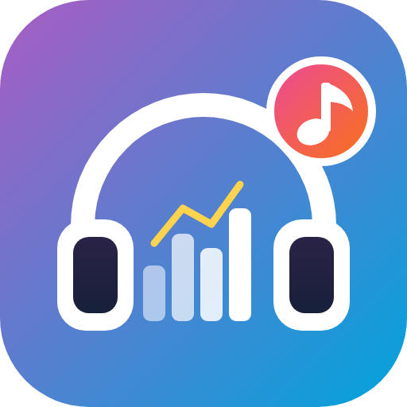

<p align="center"></p>

<h1 align="center">Jellyfin Music Stats</h1>

🇬🇧 [English](#english) · 🇩🇰 [Dansk](#dansk)

---

## English

A Home Assistant add-on with listening statistics for music in Jellyfin, meant as a music version of Jellystat. The add-on's own pages are in Danish.

- Plays and listening time per day, week and month, compared with the previous period
- Top artists, albums and songs with covers
- Genres and music moods over time, and moods through the day
- Heatmap of when you listen
- Smarter numbers: skip rate, listening sessions, streaks, new artists, repeats and automatic insights
- Live "now playing"
- Artist pages with history, top songs, albums and times of day
- Wrapped: a yearly summary with listener type, artist of the year, top 5 lists and fun facts
- User comparison with a music taste match and shared artists
- CSV export of plays (opens directly in Danish Excel)
- Multiple users

See [jellyfin_music_stats/DOCS.md](jellyfin_music_stats/DOCS.md) for setup (in Danish).

### Installation in Home Assistant

1. Go to **Settings → Apps → App store → ⋮ → Repositories**.
2. Add `https://github.com/Tntdruid/jellyfin-music-stats`.
3. Find **Jellyfin Music Stats** in the store and install it.

Home Assistant builds the add-on on your machine, so the first installation takes a few minutes.

**Updates:** raise `version` in `jellyfin_music_stats/config.yaml` and push. Home Assistant then shows the update in the store.

### Local development with demo data

```bash
python -m venv .venv
.venv/Scripts/pip install -r jellyfin_music_stats/app/requirements.txt
curl -L -o jellyfin_music_stats/app/static/echarts.min.js https://cdn.jsdelivr.net/npm/echarts@5.5.1/dist/echarts.min.js
.venv/Scripts/python dev/seed_demo.py
cd jellyfin_music_stats/app && DATA_DIR=../../dev/data ../../.venv/Scripts/python -m uvicorn main:app --port 8099
```

If you set `JELLYFIN_URL` and `API_KEY` as environment variables, the local copy also collects real data.

---

## Dansk

Home Assistant-add-on med lyttestatistik for musik i Jellyfin. Det er tænkt som en musikudgave af Jellystat.

- Lytninger og lyttetid pr. dag, uge og måned, sammenlignet med forrige periode
- Top kunstnere, albums og sange med covers
- Genrer og musikhumør over tid samt humør i løbet af døgnet
- Heatmap over, hvornår du lytter
- Smartere tal: skip-rate, lyttesessioner, streaks, nye kunstnere, gentagelser og automatiske indsigter
- Live "spiller nu"
- Kunstnersider med historik, top-sange, albums og tidspunkter på døgnet
- Wrapped: årsoversigt med lyttertype, årets kunstner, top 5-lister og sjove fakta
- Sammenligning af brugere med musiksmag-match og fælles kunstnere
- Eksport af afspilninger til CSV (åbner direkte i dansk Excel)
- Understøtter flere brugere

Se [jellyfin_music_stats/DOCS.md](jellyfin_music_stats/DOCS.md) for opsætning.

### Installation i Home Assistant

1. Gå til **Indstillinger → Apps → Apps butik → ⋮ → Repositories**.
2. Tilføj `https://github.com/Tntdruid/jellyfin-music-stats`.
3. Find **Jellyfin Music Stats** i butikken og installér det.

Home Assistant bygger add-on'et på din maskine, så den første installation tager et par minutter.

**Opdateringer:** Hæv `version` i `jellyfin_music_stats/config.yaml` og push. Home Assistant viser så opdateringen i butikken.

### Lokal udvikling med demodata

```bash
python -m venv .venv
.venv/Scripts/pip install -r jellyfin_music_stats/app/requirements.txt
curl -L -o jellyfin_music_stats/app/static/echarts.min.js https://cdn.jsdelivr.net/npm/echarts@5.5.1/dist/echarts.min.js
.venv/Scripts/python dev/seed_demo.py
cd jellyfin_music_stats/app && DATA_DIR=../../dev/data ../../.venv/Scripts/python -m uvicorn main:app --port 8099
```

Hvis du sætter `JELLYFIN_URL` og `API_KEY` som miljøvariabler, opsamler den lokale udgave også rigtige data.

---

<!-- jellyfin-projects:start -->
## More Jellyfin projects / Flere Jellyfin-projekter

| | 🇬🇧 | 🇩🇰 |
|---|---|---|
| [Jellyfin Video Stats](https://github.com/Tntdruid/jellyfin-video-stats) | Home Assistant add-on with viewing stats for movies, series and YouTube videos: progress, binges, transcoding, Wrapped | Home Assistant-add-on med seerstatistik for film, serier og YouTube-videoer: fremdrift, binge, transcoding, Wrapped |
| [Episode Title Fixer](https://github.com/Tntdruid/jellyfin-plugin-episode-title-fixer) | Jellyfin plugin that replaces placeholder episode titles like "Episode 11" with the original title | Jellyfin-plugin, der erstatter pladsholdere som "Afsnit 11" med afsnittets originale titel |
| [Auto Artist Playlists](https://github.com/Tntdruid/jellyfin-plugin-auto-artist-playlists) | Jellyfin plugin that hearts the songs you listen to and adds them to a playlist per artist | Jellyfin-plugin, der giver hjerte til de sange, du hører, og samler dem i en playliste pr. kunstner |
<!-- jellyfin-projects:end -->
